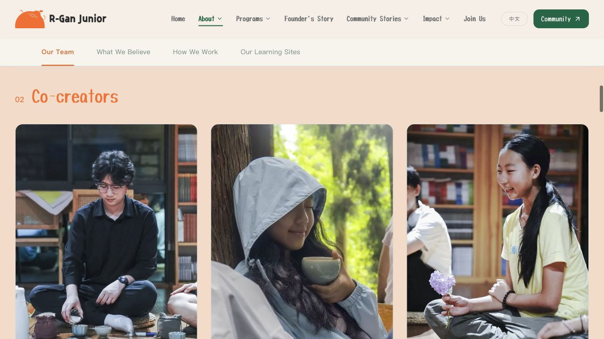

# 守护团照片与伙伴称呼发布 · 2026-10-18

已发布至 https://www.rganjunior.org 。共创伙伴固定为 **Co-creators**，合作伙伴固定为 **Partners**。本次同时发布渠自、敬请期待、蔷薇、智華的照片与面部取景；蔷薇替换原 guardian-06，保留链接，名录共 19 项。

## 版本对应

- 应用提交：`f1f8d73718e46e39d5cfd2cfcf67d8a38b6fe153`（包括照片提交 `5255161`）。
- Vercel：`dpl_Bg9qxHHYBPMu6XRFuGK3ZMUEQQqV`，production / Ready；正式域名查询确认指向本部署。
- 上一部署：`dpl_627soWAmWD68GVeRbu1ADTLFoNJs`。
- 没有数据库迁移或数据库写入；并行的登录/密码修改不属于此次发布。
- [版本回归审查](../version-audit-2026-10-18.md) 记录原因、历史差异和近期功能保留情况。

## 本地检查与发布方式

从固定提交导出到独立目录，核对 1,611 个跟踪文件，零差异。使用本地生产配置构建；105 个测试文件、407 项测试通过，应用与后端/API 类型检查通过，lint 0 错误、11 条既有 Fast Refresh 警告。

本机 `vercel build --prod` 成功后，以 `--prebuilt --prod --skip-domain` 上传。核对 index、About/guardian 脚本及四张照片共 7 个文件的 SHA-256 全部相同，再提升至正式域名。GitHub 仅执行代码检查，没有构建或部署。构建摘要见 release.json。

[GitHub 应用提交检查](https://github.com/RuikangWNemo/RganJunior/actions/runs/39098951084) 已全部通过。

## 浏览器验收与边界

- 本地生产预览：中英文 Co-creators、Partners，三位伙伴角色，19 位守护团与蔷薇去重；四张新图与面部位置、资料页及后退正常。
- 本地 390px 宽度的关于页无横向溢出；实际社区文章正文为常规字体、400 字重，标题仍为展示字体。
- 正式站：关于页中文“共创伙伴”及英文“Co-creators”、三位伙伴角色；加入页“Partners”。
- 正式站：19 个守护团入口，四张新图全部加载，CSS 面部位置与本地相同；蔷薇原资料链接和浏览器后退正常，检查期间未捕获控制台 error。
- 本次没有 Windows 实机、真实邮件投递、全部管理员写入流程验收；不将页面可访问等同于全功能验证。
- 本地预览保留在 http://127.0.0.1:5188/ 。

